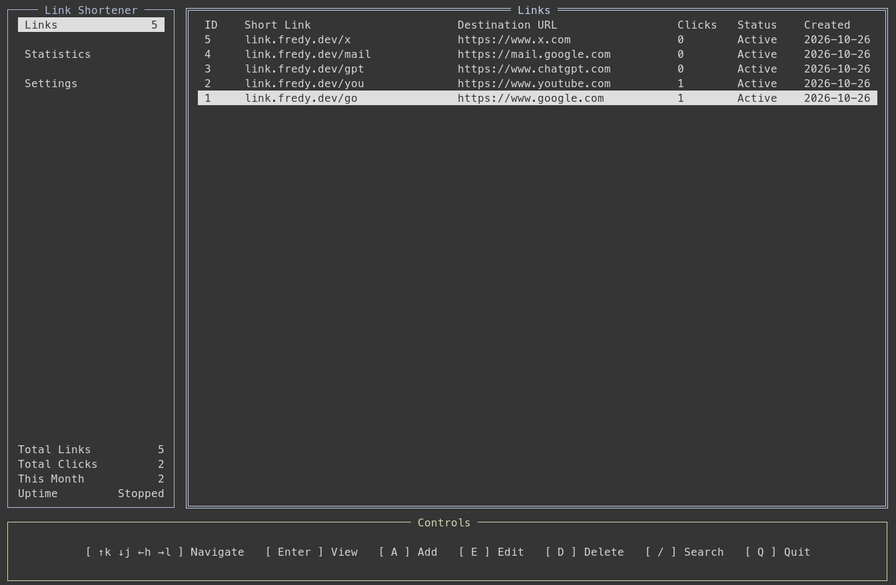

# sho-rt

A single-binary Go link shortener with a keyboard-first dashboard, SQLite storage, and a native background service.

[](assets/screenshot-cli-sho-rt.png)

Public redirect API: [OpenAPI specification](api/openapi.json).

## Install a release

Linux and macOS are supported on ARM64 and AMD64. No Go installation is needed:

```sh
curl -fsSL https://raw.githubusercontent.com/FredySandoval/sho-rt/main/install.sh | bash
sho-rt
```

The installer verifies SHA-256 checksums and uses `/usr/local/bin` when writable,
otherwise `~/.local/bin`. It does not use sudo or install a service automatically.
You can inspect `install.sh` before running it. Override the version or destination:

```sh
curl -fsSL https://raw.githubusercontent.com/FredySandoval/sho-rt/main/install.sh | VERSION=v0.1.0 INSTALL_DIR="$HOME/.local/bin" bash
```

Release binaries support self-update:

```sh
sho-rt --version
sho-rt update --check
sho-rt update
```

Settings also offers **Check for updates** and **Update application** (confirmation
required). Updates verify SHA-256 checksums and atomically replace the executable;
the binary directory must be writable. Restart the dashboard and any background
service afterward. Development builds (`dev`) must first install a stable release.
Only newer stable versions are installed; configuration and databases are untouched.

You can also re-run the installer to update. Stop the native service before updating, then restart it from
the dashboard. Configuration and databases are not changed by the installer.

## Build and run

```sh
CGO_ENABLED=0 go build -trimpath -ldflags='-s -w' -o sho-rt .
./sho-rt
```

Go 1.27 or newer is required to build the currently pinned dependencies. The resulting binary requires no Go installation, C library, database server, or external runtime. Keep it at a permanent path before installing a service.

## Dashboard

- **Tab** switches between sidebar and content; **↑/↓**, **Enter** navigate.
- **1–4** open Links, Add Link, Statistics, and Settings.
- **A** creates a link; **E** edits; **D** requests deletion confirmation.
- **T** enables/disables the selected link; **Enter** shows its full destination and statistics.
- **/** searches aliases and destinations; **Esc** leaves search or clears the filter.
- Forms use **Tab**, **Shift+Tab**, and **Enter**; **Esc** cancels.
- **Q** quits outside forms; **Ctrl+C** always exits.

The terminal should be at least 60 columns × 18 rows. A wider terminal shows the full table. The dashboard refreshes statistics every three seconds.

## Settings and background operation

All normal management is inside Settings:

| Key   | Action                                                                 |
| ---   | ---                                                                    |
| E     | Edit listening IP, port, public domain, and database location          |
| S / X | Start / stop the foreground HTTP server                                |
| I / R | Install / remove the persistent native service (confirmation required) |
| B / Z | Start / stop the native background service                             |
| U     | Restart the native service                                             |
| O     | Enable / disable automatic startup                                     |

The local server stops when the dashboard exits. The native service runs independently and survives closing the dashboard. A listener bind prevents duplicate servers on the same address and port. Stop the local server before switching to daemon mode; **B** does this automatically.

Native management uses systemd on Linux, launchd on macOS, and Windows Services on Windows. Installation/removal and startup changes may require administrator permissions; errors appear in the dashboard. Linux requires a functioning systemd service manager. Automatic startup changes re-create an installed service while preserving its running state. Service integration is platform-dependent; automated tests do not install or modify host services.

Default listening address: `127.0.0.1:3000`. To use `https://example.com/alias`, configure DNS and a TLS reverse proxy forwarding to this address, or configure an appropriate public listening address. Changing the display domain does not configure DNS, TLS, or open firewall ports. There is no remote management endpoint.

## Persistence

Configuration lives under the OS application configuration directory, in `sho-rt/config.json`; SQLite defaults to `sho-rt/links.db` alongside it. Both paths are shown or editable through Settings. No manual configuration editing is necessary.

SQLite uses WAL, foreign keys, a busy timeout, transactional migrations, unique aliases, and atomic click-count/event updates. Only GET redirects count as clicks; HEAD checks do not. Missing links return 404, disabled links 410, unsupported methods 405, and unavailable storage 503. URLs must use HTTP or HTTPS without embedded credentials.

Changing the database location copies a consistent SQLite snapshot to a **new, nonexistent absolute path**, retaining the original database as a backup. Stop the native service before moving the database. Local listeners restart when network settings change. Back up SQLite using its backup facilities, or stop all writers before copying the database and WAL files.

Click events contain only link IDs and UTC timestamps, not visitor IP addresses. Deleting a link also deletes its click events. Events currently have no retention limit.

## Layout

- `internal/config`: OS-specific paths and atomic configuration persistence
- `internal/store` : pure-Go SQLite, embedded migrations, validation, links, click events
- `internal/server`: HTTP redirects and graceful listener lifecycle
- `internal/daemon`: native service integration
- `internal/tui`   : Bubble Tea v2, Bubbles v2, Lip Gloss v2, Huh v2 dashboard

## Tests

```sh
go test -race ./...
go vet ./...
```

Tests cover URL/alias validation, alias generation, persistence, relocation, duplicate aliases, statistics, redirect behavior, listener lifecycle, and the service program's start/stop lifecycle. Native service installation needs testing on each target OS with the appropriate permissions.
